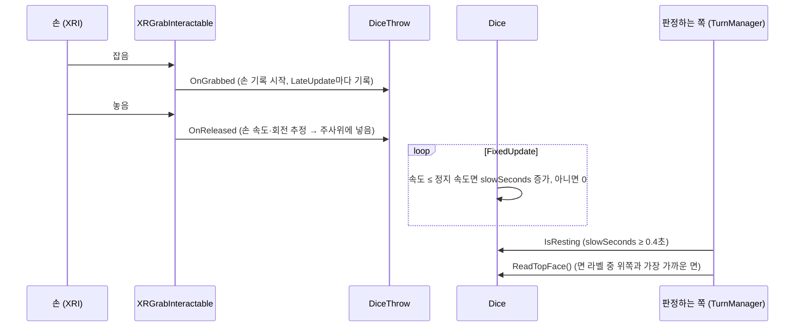
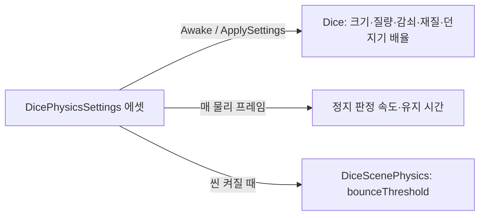

# #1 주사위 (`Dice`, `DiceThrow`, `DicePhysicsSettings`)

검토할 코드: `Dice.cs`, `DiceThrow.cs`, `DicePhysicsSettings.cs`, `DiceScenePhysics.cs`

## 던지기와 정지·윗면 읽기

## 튜닝 흐름

## 확인 포인트
- 주사위 크기는 에셋 값이 정한다 (프리팹 스케일 수정은 무효).
- `DiceThrow`는 회전 감쇠를 건드리지 않는다.
- 확인 키: `Test/TestDiceKeys.cs` F4 던지기, F5 집기 토글, F6 튜닝 재적용.
