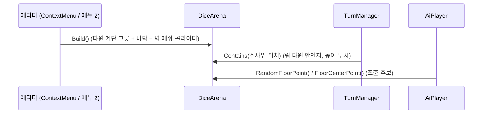
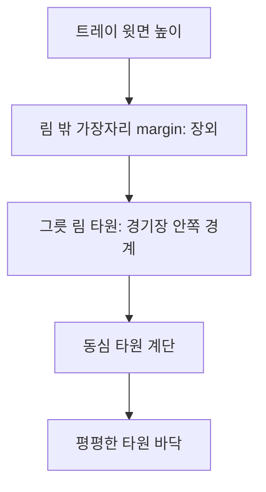

# #2 경기장 (`DiceArena`)

검토할 코드: `DiceArena.cs`(`Build`, `Contains`, `RandomFloorPoint`, `FloorCenterPoint`), `Editor/ArenaSetup.cs`

## 만들기와 판정에 쓰이는 방식

## 모양

## 확인 포인트
- 림 타원 안쪽만 경기장 안이다. 가장자리 margin에 선 주사위는 장외.
- 프리팹에 들어간 경기장 모양을 바꾸려면 프리팹을 지우고 메뉴 3을 다시 실행한다.
