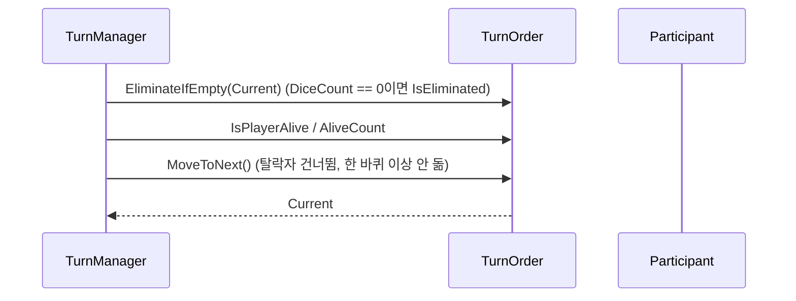
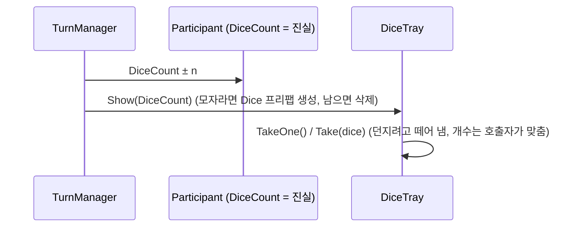

# #4 순서 관리 + 트레이 + 원형 탁자

검토할 코드: `Participant.cs`, `TurnOrder.cs`, `DiceTray.cs`, `DiceTable.cs`, `Editor/TableSetup.cs`

## 순서와 탈락


## 트레이는 개수를 보여 주기만 한다


## 원형 탁자 프리팹 (메뉴 3)
```mermaid
flowchart TD
    M[메뉴 3 TableSetup] --> T[Round Table 4P / 5P]
    T --> A[가운데 DiceArena]
    T --> S[자리별 DiceTray: 0번 = 플레이어(-Z), 시계 방향]
    T --> F[윗판·기둥·받침 (겉모습)]
    T --> D[DiceTable: Arena, SeatTrays를 TurnManager에 알림]
```

## 확인 포인트
- 트레이 주사위는 물리를 켠 채 바닥에 얹는다 (XRI가 놓을 때 kinematic을 되돌려 던진 주사위가 굳는 문제 때문).
- 탁자 Scale은 1로 둔다 (Dice는 크기를 절대 값으로 정한다).
- 논리는 레포 밖 dotnet 콘솔로 15건 검증했다.
