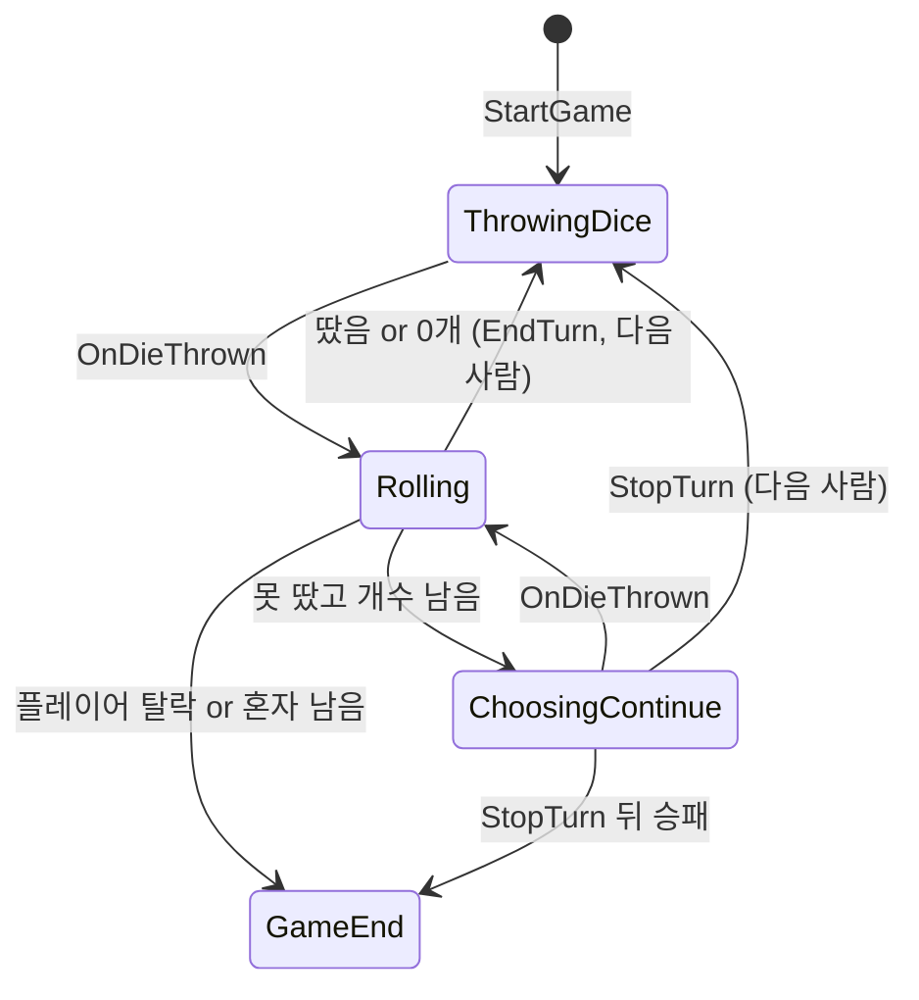
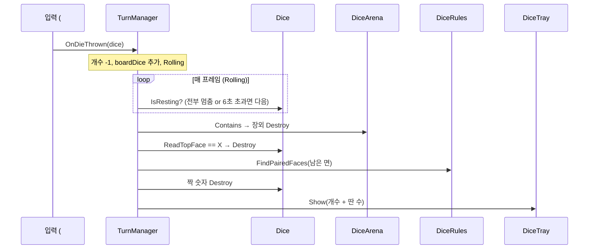
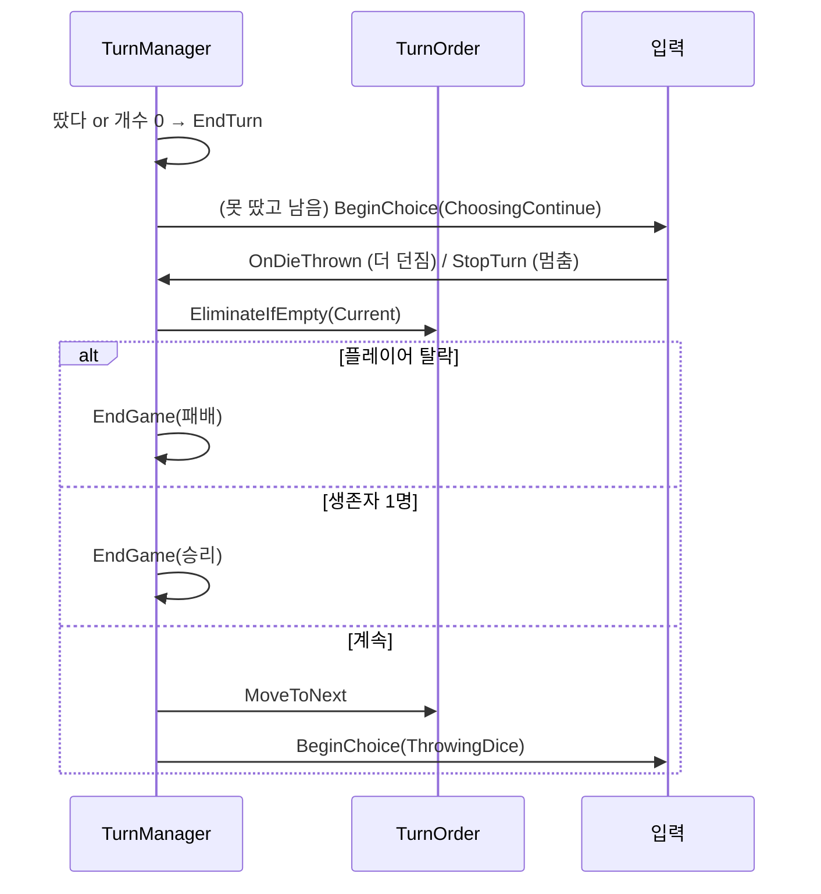

# #5 턴 진행 (`TurnManager`)

검토할 코드: `Assets/10. Scripts/07. MR Strike/TurnManager.cs` (`Update` → `FinishRolling` → `JudgeBoard` → `EndTurn`)

## 상태 전이

## 던진다 → 굴러서 멈춘다 → 판정한다

## 고른다 · 넘긴다

## 확인 포인트
- 못 딴 주사위는 `boardDice`에 남아 다음 사람 판정에 합쳐진다.
- 마지막 주사위를 던져 못 따면 `ChoosingContinue` 없이 바로 탈락한다.
- 확인 키: `Test/TestTurnKeys.cs` F8 던지기, F9 멈춤, F10 새 판, F11 자동.
