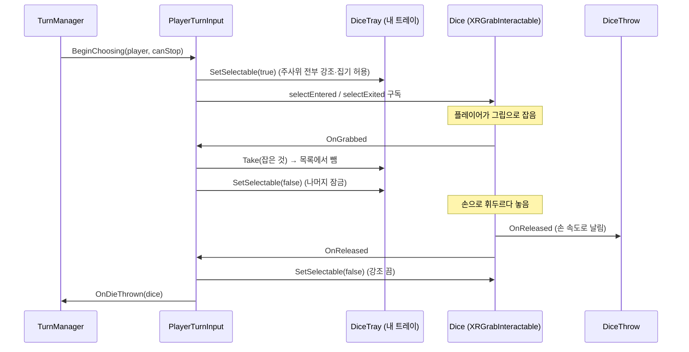
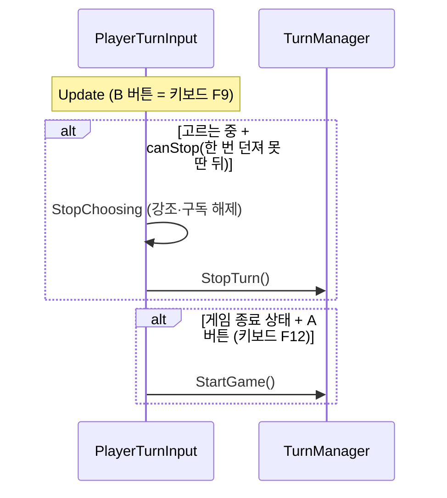

# #6 플레이어 입력 (`PlayerTurnInput`)

검토할 코드: `Assets/10. Scripts/07. MR Strike/PlayerTurnInput.cs`, `TurnManager.BeginChoice`, `DiceTray.Take`/`DiceInTray`

## 내 차례: 잡기 → 놓기 → 던짐 알림

## 멈춤 · 새 판

## 확인 포인트
- 첫 던지기 전(`ThrowingDice`)은 `canStop=false`라 B가 안 먹는다.
- 잡았다 놓으면 어디에 놓든 던진 것으로 친다 (트레이에 떨어뜨리면 장외로 지워짐).
- `TestTurnKeys`의 F8~F11은 키보드 전용으로 바꿨다 (헤드셋에서 B·A와 겹치지 않게).
- Inspector: `TurnManager.playerInput`, `PlayerTurnInput.turnManager` 연결.
