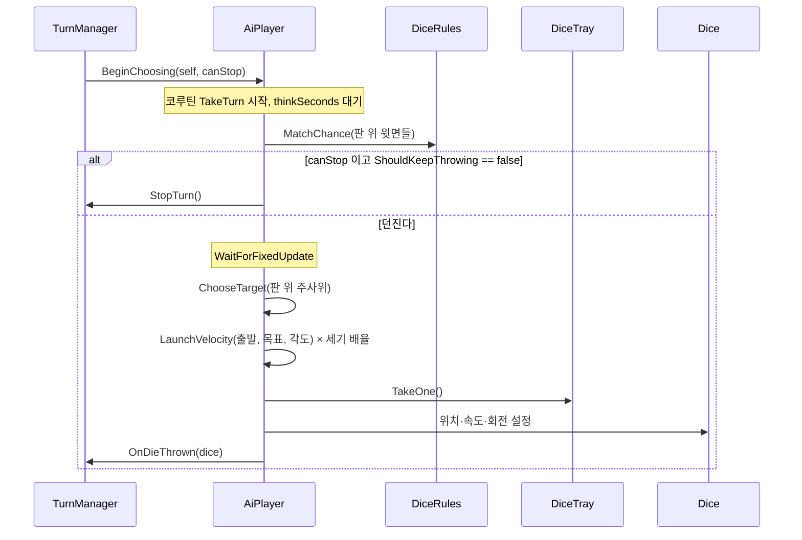
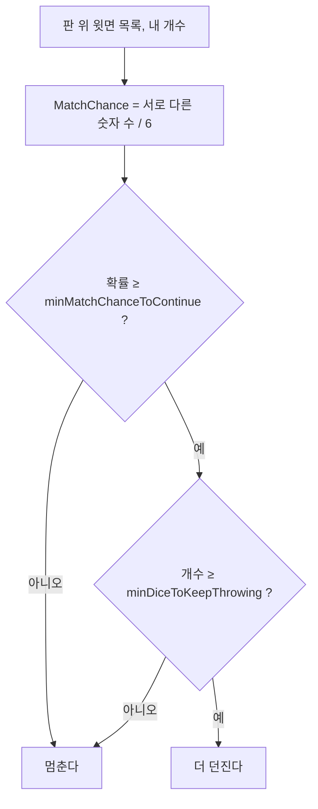

# #7 AI 던지기 전략 (`AiPlayer`, `AiPersonality`)

검토할 코드: `Assets/10. Scripts/07. MR Strike/AiPlayer.cs`, `AiPersonality.cs`, `TurnManager.BeginChoice`·`CancelAiTurns`, `Editor/TurnSystemSetup.cs`(메뉴 4)

## AI 차례 전체 (코루틴)


## 멈춤 판단 `ShouldKeepThrowing`

첫 던지기(`canStop=false`)에는 판단 없이 반드시 던진다.

## 목표 고르기 `ChooseTarget` + 포물선 `LaunchVelocity`
```mermaid
flowchart TD
    S{throwStyle}
    S -- Smash --> A[이웃(0.06 m)이 가장 많은 주사위 위치]
    S -- Gentle --> B[바닥 무작위 20점 중 판 위 주사위에서 가장 먼 점]
    S -- Center --> C[경기장 바닥 한가운데]
    A --> E[+ 조준 오차 aimErrorRadius]
    B --> E
    C --> E
    E --> F[LaunchVelocity: 각도 고정, 목표에 닿는 속도]
    F --> G[× throwSpeedScale]
```
포물선: `v² = g·d² / (2cos²θ·(d·tanθ − h))` (d = 수평 거리, h = 목표 높이 − 출발 높이).

## 기본 성격 (가정, `Settings/` 에셋으로 생성, 값은 에셋에서 수정)
| 이름 | 멈춤 | 방식 | 각도 | 세기 | 오차 |
|---|---|---|---|---|---|
| 불도저 | 확률 0 / 개수 1 (끝까지) | Smash | 15° | ×1.4 | 0.08 m |
| 신중이 | 확률 0.7 / 개수 3 (거의 바로 멈춤) | Gentle | 60° | ×1.0 | 0.02 m |
| 도박사 | 확률 0.4 / 개수 2 | Center | 40° | ×1.15 | 0.04 m |

## 확인 포인트
- 새 판(`StartGame`)은 `CancelAiTurns`로 AI 코루틴을 끊는다. 안 끊으면 옛 AI가 새 판에 던진다.
- `Participant.Ai == null`이 플레이어다 (`IsPlayer`는 이 값에서 계산).
- 씬 연결은 메뉴 `StudyXR/MR Strike/4. 턴 시스템 추가` 한 번 (탁자가 열린 씬에 있어야 함).
- `TestTurnKeys`는 이제 플레이어 차례에만 대신 던진다 (F8). AI 차례는 스스로 진행.
