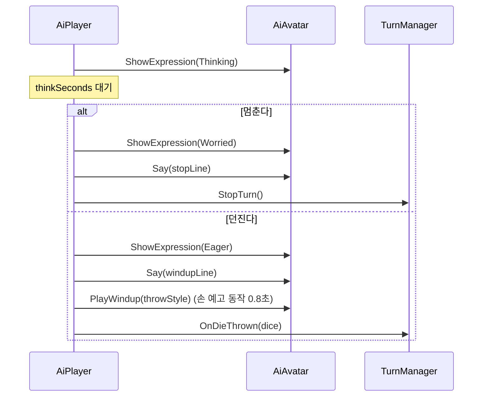
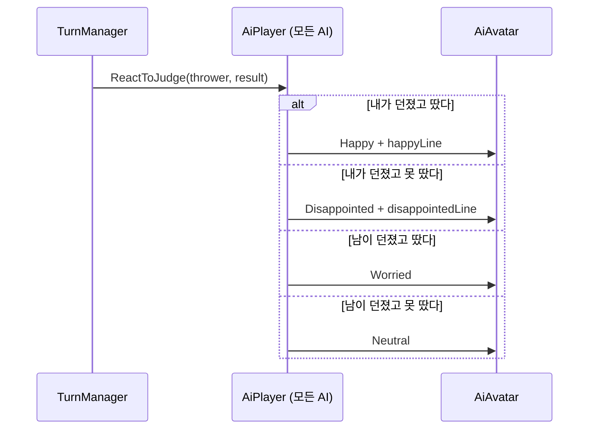

# #8 AI 성격 단서 (`AiAvatar`)

검토할 코드: `Assets/10. Scripts/07. MR Strike/AiAvatar.cs`, `AiPlayer.cs`(`TakeTurn`, `ReactToJudge`), `AiPersonality.cs`(머리 색·대사), `TurnManager.NotifyAiReactions`, `Editor/TurnSystemSetup.cs`(아바타 생성)

## AI 차례 연출 순서

## 판정 결과 반응

## 성격을 알아차리는 단서 3가지
| 단서 | 불도저 | 신중이 | 도박사 |
|---|---|---|---|
| 머리 색 | 빨강 | 파랑 | 노랑 |
| 예고 동작 | Smash: 손을 번쩍 들었다 내려찍기 | Gentle: 작게 천천히 흔들기 | Center: 손으로 원 그리기 |
| 대사 | "다 부숴 주마!" | "조심조심..." | "운을 걸어 볼까!" |

## 확인 포인트
- 얼굴은 글자 이모티콘(`o_o`, `>w<`, `^_^`, `T_T`, `;_;`, `o_O ?`)이다 (가정). 텍스처 교체가 아님.
- `StartGame`이 `CancelTurn`으로 연출을 끊고 손·표정을 되돌린다.
- 아바타는 메뉴 `4. 턴 시스템 추가`가 트레이 바깥쪽(0.35 m 뒤, 0.45 m 위)에 만든다. 위치·크기는 씬에서 손으로 옮겨도 된다.
- 한글 글꼴은 `NotoSansKR-Regular SDF`를 쓴다 (경로가 다르면 글자가 깨질 수 있음).
