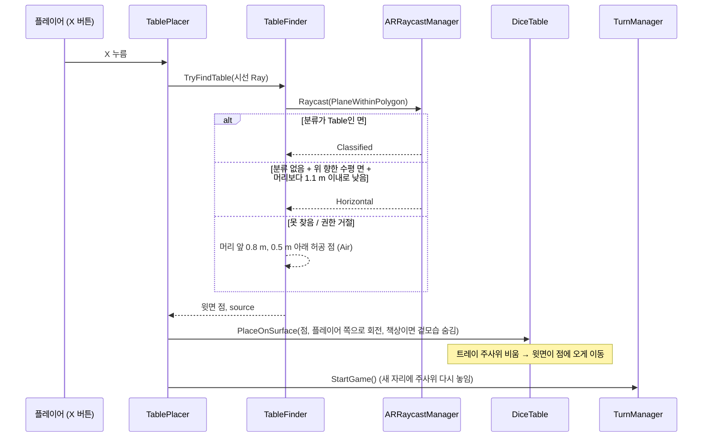
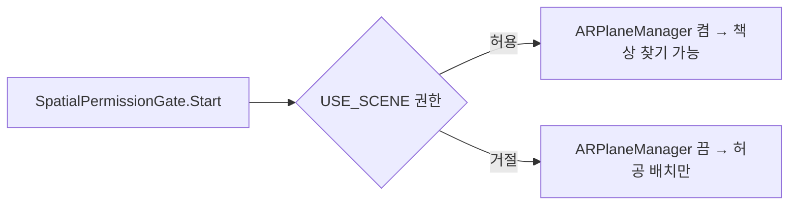

# #9 MR 책상 배치 (`TableFinder`, `TablePlacer`)

검토할 코드: `Assets/10. Scripts/07. MR Strike/TableFinder.cs`, `TablePlacer.cs`, `DiceTable.PlaceOnSurface`
재사용: `06. MR Aquarium/SpatialPermissionGate`(권한), `WallFinder`(찾는 방식을 책상용으로 복사)

> 스텐실 포털(`PortalMask`)은 이번 커밋에 넣지 않았다. 사유는 맨 아래.

## 책상에 놓기 (왼손 X, 키보드 F3)

## 권한

## 확인 포인트
- 진짜 책상에서는 가상 탁자의 윗판·기둥·받침 겉모습만 숨긴다. 충돌은 남아 주사위는 책상 높이에서 굴러간다.
- 다시 X를 누르면 그 자리에 다시 놓고 새 판을 시작한다 (진행 중이던 판은 사라짐).
- 원형 탁자가 지름 1.3 m라 작은 책상에서는 트레이가 책상 밖으로 나갈 수 있다 (가정). 필요하면 반지름을 줄여 프리팹을 다시 만든다.
- 씬 구성 (MR 씬에서 한 번): `TableFinder`(ARRaycastManager, 카메라), `TablePlacer`(finder, table, turnManager, 카메라), `SpatialPermissionGate`(managers에 ARPlaneManager). 헤드셋 확인 필요 (시뮬레이터에서는 허공 배치만 확인 가능).

## 포털을 뺀 이유
- 스텐실 포털은 `PortalMask` 셰이더 + 경기장 재질에 스텐실 비교 + URP 렌더러 설정이 함께 맞아야 한다.
- 헤드셋에서만 결과를 볼 수 있어 검토 없이 만들면 틀려도 알 수 없다. 책상 배치가 헤드셋에서 확인된 뒤 별도 커밋으로 진행하는 것이 안전하다.
