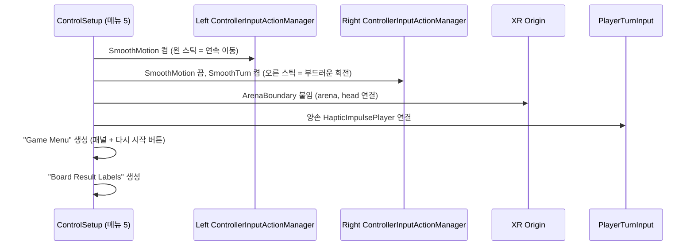
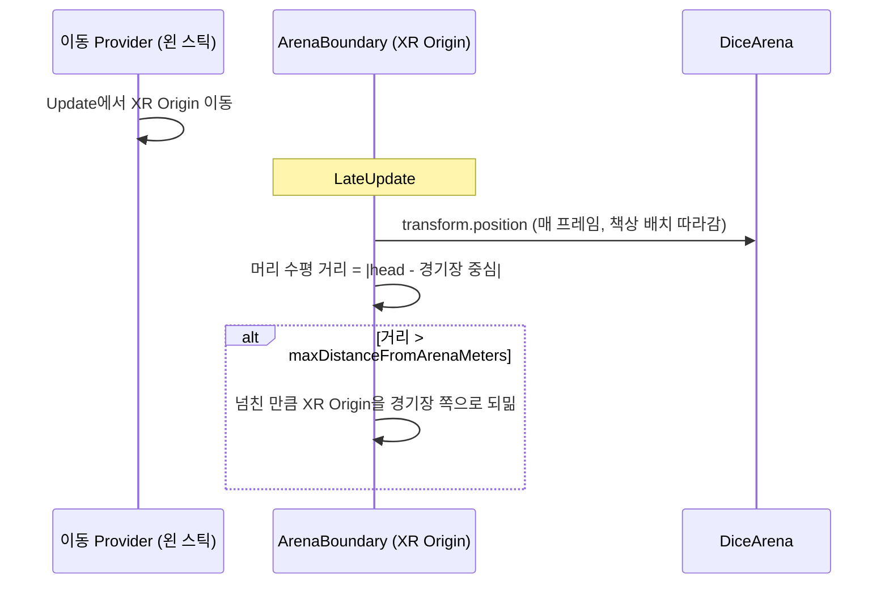
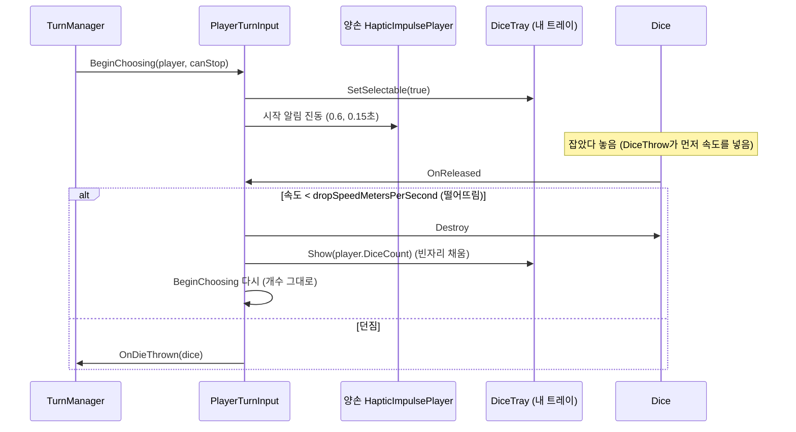
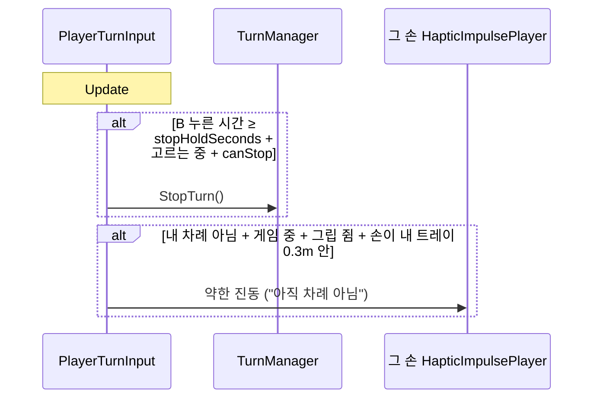
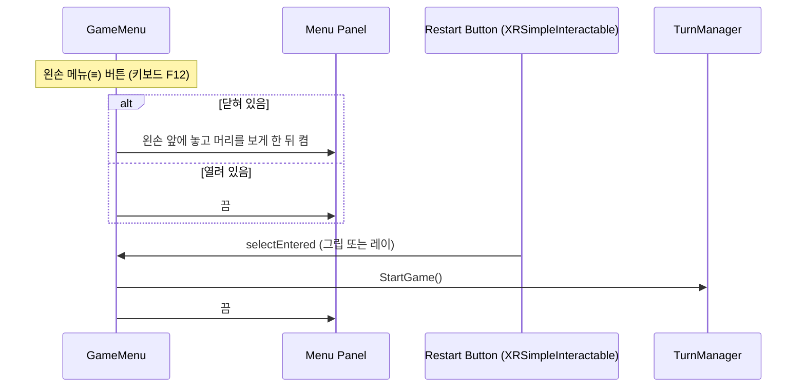
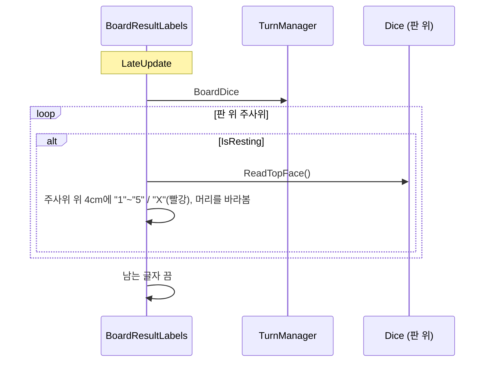

# #10 조작 UX (`ArenaBoundary`, `PlayerTurnInput`, `GameMenu`, `BoardResultLabels`)

검토할 코드: `Assets/10. Scripts/07. MR Strike/ArenaBoundary.cs`, `PlayerTurnInput.cs`, `GameMenu.cs`, `BoardResultLabels.cs`, `Editor/ControlSetup.cs`
설계 결정: `C:\Users\hsgood01\.claude\plans\snug-stirring-metcalfe.md`

## 원인: 스틱으로 회전만 되던 이유
- 씬 XR Origin(Starter Assets 프리팹) 오버라이드에서 Left `ControllerInputActionManager.m_SmoothMotionEnabled = 0` → 왼 스틱이 **텔레포트**(밀어서 조준, 놓으면 이동)였다.
- 오른 스틱은 프리팹 기본 **스냅 턴**. 계획 #1~#9에는 이동 설계가 없었다.

## 씬 적용: 메뉴 `StudyXR/MR Strike/5. 조작 UX 적용`

- 메뉴 1·3·4를 먼저 실행해 XR Origin, `DiceTable`, `TurnManager`/`PlayerTurnInput`이 씬에 있어야 한다.
- 두 번 실행해도 컴포넌트·오브젝트는 하나만 생긴다.

## A. 경기장 주위 이동 + 거리 제한

- 실제로 걸어 나가도 같은 규칙이다 (머리 위치 기준).

## B. 플레이어 입력 정리

- A 버튼 재시작은 없앴다 (오입력 방지). 키보드 F9 = B 대체는 그대로.

## C. 메뉴 다시 시작

- 일시정지는 없다 (턴제). 메뉴가 열려 있어도 게임은 진행된다.

## D. 판 위 결과 숫자

- 트레이 주사위에는 안 띄운다. 굴러가는 동안은 숨긴다.

## (가정) 목록
| 값 | 위치 | 기본 |
|---|---|---|
| 최대 거리 | `ArenaBoundary.maxDistanceFromArenaMeters` | 1.2 m |
| 멈춤 누르기 시간 | `PlayerTurnInput.stopHoldSeconds` | 0.6 초 |
| 떨어뜨림 속도 기준 | `PlayerTurnInput.dropSpeedMetersPerSecond` | 0.5 m/s |
| 차례 시작 진동 | `turnStartAmplitude` / `turnStartSeconds` | 0.6 / 0.15초, 양손 |
| 차례 아님 진동 | `notYourTurnAmplitude` / `notYourTurnSeconds` / `notYourTurnReachMeters` | 0.2 / 0.05초 / 0.3 m |
| 메뉴 위치 | `GameMenu.offsetFromHandMeters` | 왼손 앞 15cm, 위 8cm |
| 결과 숫자 | `BoardResultLabels.heightAboveDiceMeters` / `fontSize` | 4cm / 0.25 |

## 계획과 다른 점
- `DiceTray`에 복귀 메서드를 추가하지 않았다. 개수의 진실이 그대로이므로 기존 `Show(player.DiceCount)`가 빈자리를 채운다.
- 짝 하이라이트는 빠졌다. 짝은 판정 순간 바로 지워져(`TurnManager.TakePairedDice`) 강조할 시간이 없다 → 추후 검토(지우기 전 잠깐 보여 주기).
- "아직 차례 아님"은 진동만. 글자 표시는 추후 검토. 레이로 원거리에서 쥐는 경우는 못 잡는다 (손이 트레이 0.3m 안일 때만).
- 셰이더 floating 효과 대신 TextMeshPro 글자로 먼저.

## 확인 포인트
- Unity 컴파일 확인 안 됨 (에디터 미실행). 새 스크립트 `.meta`는 Unity가 만든다.
- 메뉴 5 실행 후 씬 저장.
- 왼 스틱 연속 이동, 오른 스틱 부드러운 회전. 속도는 XR Origin의 Move/Turn Provider 인스펙터.
- 경기장에서 멀어지면 막힘. Play 중 `maxDistanceFromArenaMeters` 바꾸면 바로 반영.
- 원거리 잡기: Starter 리그 Near-Far Interactor로 이미 되는지 확인. 안 되면 Dice 프리팹 `XRGrabInteractable` far 설정 확인.
- B 짧게 = 무시, 길게 = 멈춤 / 차례 시작 진동 / 트레이 위에 툭 놓으면 복귀, 휘둘러 던지면 판정 / A 무반응.
- 왼손 ≡ → 패널 → 다시 시작 → 새 판.
- 주사위 멈추면 숫자, X는 빨강.
- 보류: 스틱 매핑 세부(사용자 조사 후). 시야는 변경 없음(아래 "시야 각도" 절).

## 후속 (2026-11-23)
### 시야 각도 (15~30° 내려다보기) — 변경 없음
- MR에서는 경기장이 실제 책상 위에 놓인다(#9 `TablePlacer`). 경기장 높이 = 실제 책상 높이라 코드 값이 아니다.
- 내려다보는 각도 = atan(눈높이 - 책상 높이, 경기장 중심까지 수평 거리).
- (가정) 서 있는 눈높이 1.6 m, 책상 0.75 m → 높이 차 0.85 m.

| 경기장까지 거리 | 내려다보는 각도 |
|---|---|
| 0.5 m (팔 닿는 거리) | 약 60° |
| 0.8 m | 약 47° |
| 1.2 m (`maxDistanceFromArenaMeters` 한계) | 약 35° |
| 1.5 m | 30° |
| 3.2 m | 15° |

- 결론: 서서 하면 거리 제한 1.2 m 안에서는 35~60°다. 15~30°는 1.5~3.2 m 떨어져야 해서 던지기 거리·"멀리서 약하게 던짐 방지"와 충돌한다.
- 사용자 확인(헤드셋): 지금 경기장은 괜찮다 → 높이·거리 변경 없음. 아래는 참고용 다른 선택지.
  1. 각도 목표를 35~60°로 바꾼다 (코드 변경 없음).
  2. 앉아서 플레이(눈높이 약 1.2 m → 0.8 m 거리에서 약 27°). "서서 플레이" 결정과 충돌.
  3. 경기장을 책상 위로 띄운다(가상 받침대). 책상 0.75 m 위 +0.35 m → 1.0 m 거리에서 약 27°. MR에서 실제 책상과 떨어져 보인다.
